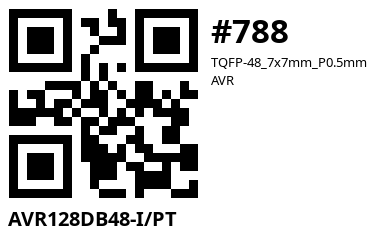

# Component inventory GUI

A PySide6 desktop application for the electronic component database
(`db/db.sqlite`). The same database backs the KiCad database library
(`db/default.kicad_dbl`) and `bomer2.py`. The application replaces hand
editing in SQLiteBrowser. It also prints QR code labels for the component
storage and works with a handheld QR code scanner.

The application keeps the database usable by KiCad and `bomer2.py`. It only
adds to the schema (see [Database changes](#database-changes)) and never
changes the existing tables or the `k10_components` view.

## Prerequisites

* Python 3
* PySide6 (`python3-pyside6` on Debian, or `pip install PySide6`)
* python3-qrcode (`apt install python3-qrcode`, or `pip install qrcode`),
  for the QR code on labels
* niimprint, for printing on the Niimbot B21S. Use the fixed version:
  <https://github.com/leventelist/niimprint/tree/fix/wait-for-print-status>

  The original version
  ([AndBondStyle/niimprint](https://github.com/AndBondStyle/niimprint)) has a
  bug. After sending the image, it waits a fixed 0.3 s and then ends the print
  job, while the printer is still printing. Ending the job early aborts the
  print, so only about the first 20 mm of a label comes out. The
  `fix/wait-for-print-status` branch asks the printer for its print status
  and ends the job only when the page is finished.

  ```
  git clone -b fix/wait-for-print-status https://github.com/leventelist/niimprint.git ~/git/niimprint
  ```

  Install its dependencies for the system `python3` (`python3-serial`,
  `python3-pil`, `python3-click` on Debian). The location `~/git/niimprint`
  can be changed in **Settings → Printer…**.

## Usage

```
./inventory_gui.py [path/to/db.sqlite]
```

Without an argument it opens the last used database, then
`../db/db.sqlite`, and otherwise asks for a file. Another database can be
opened at any time from **File → Open database…** or **File → Open recent**.
**File → Reload** re-reads the database, for example after editing it in
SQLiteBrowser.

The main window has a scan field and a search field at the top. Below them
are the category tree, the results table, and a detail panel with
Overview, Sources and History tabs.

### Keyboard shortcuts

| Key | Action |
|---|---|
| F1 | Focus the scan field |
| Ctrl+F | Focus the search field |
| F2 / F3 | Receive / consume stock for the selected component |
| F4 | Stock settings (warning level, location) |
| Ctrl+Z | Undo the last stock change of the selected component |
| Ctrl+P | Print labels for the selected components |
| Ctrl+N / Ctrl+E / Ctrl+D | New / edit / duplicate component |
| Shift+Del | Delete component |
| Ctrl+O / Ctrl+R / Ctrl+Q | Open database / reload / quit |

The menus are File, Component (new, edit, duplicate, delete, print, suppliers),
Stock (receive, consume, settings, undo, Deduct BOM, low stock report, stock
history), Settings (label, printer) and Help.

## Features

### Searching and browsing

* Free-text search over value, value2, value3, type, description, category,
  keywords, footprint, ordering codes and storage location. All words must
  match. `id:<n>` matches exactly that id, while a plain number matches
  anything containing it.
* Category tree, built from `category.parent`. Selecting a category also
  shows the components of its subcategories.
* Stock filter: all, in stock, out of stock, or low stock (quantity at or
  below the warning level).
* Sortable results table: id, value, value2, value3, category, footprint,
  quantity (red at or below the warning level) and location.
* Detail panel: device fields, KiCad symbol, footprint and 3D model, a
  clickable datasheet link, sources with supplier, ordering code and price,
  stock, and the stock history.

### Scanning

The handheld scanner works as a USB keyboard. Scanned codes go into the scan
field, which has focus when the application starts. F1 brings focus back to
it.

* Scanning one of the application's own labels (`KC:<id>`) is an exact
  match. The search becomes `id:<id>` and the category and stock filters are
  cleared, so the list shows only that component, already selected. If no
  component has that id, the status bar says so and the view does not change.
* A scanned bare number is treated the same way if a component with that id
  exists. This covers older labels.
* Distributor bag codes are recognised (see below). Any other code is put
  into the search field.

To book stock with the scanner: scan the label, press F2 or F3, type the
quantity, and press Enter. Focus returns to the scan field for the next
label.

### Scanning distributor bags

| Distributor | Code | Read from it |
|---|---|---|
| DigiKey | Data Matrix, ISO/IEC 15434 | DigiKey part number, manufacturer part number, quantity, order |
| Mouser | Data Matrix, ISO/IEC 15434 | manufacturer part number, manufacturer, quantity, order |
| LCSC | QR code `{pbn:…,pc:C…,pm:…,qty:…}` | LCSC part number, manufacturer part number, quantity, order |
| TME | QR code `QTY:… PN:… MPN:… PO:…` | TME part number, manufacturer part number, quantity, order |

* The code is matched to components through the sources (ordering code of
  that distributor, any ordering code, or a Mouser style `<prefix>-<MPN>`
  code) and through the value (manufacturer part number). The distributor is
  found in the supplier list by name (`digikey`, `mouser`, `lcsc`, `tme`).
* One match: the component is shown and the Receive dialog opens with the
  quantity and "<distributor> order <number>" filled in. Several matches: you
  pick one. No match: you can create a new component with the value, a
  source with the ordering code, and the received quantity filled in.
* DigiKey and Mouser codes separate their fields with the control characters
  GS and RS. The scan field keeps them and shows them as ␝ and ␞. Many
  scanners drop them in keyboard mode; the application then says so, and the
  scanner has to be configured to send them (as Ctrl+], or as the text `{GS}`,
  which is also accepted).
* The formats follow the distributors' published label formats. They are not
  yet tested with real bags.

### Components

* **New** (Ctrl+N), **Edit** (Ctrl+E or double-click) and **Duplicate**
  (Ctrl+D) open the component dialog, which saves everything in one
  transaction:
  * **Device**: category (tree with filter and "New subcategory…"), value
    (required), value2, value3, technology, type, description, datasheet URL,
    comment.
  * **KiCad**: symbol, footprint, 3D model, short footprint (used by
    bomer2.py for JLC), description, keywords, footprint filters, No BOM,
    Schematic only. A KiCad row is created only when a symbol or footprint is
    given; without it the component does not appear in the KiCad chooser. If
    a component has several KiCad variants, the dialog edits variant 1 and
    keeps the others.
  * **Sources**: supplier, ordering code, price, the number of pieces the
    price is for, comment. Saving replaces all sources of the component.
  * **Stock**: quantity, warning level, location. A new component's quantity
    is logged as "initial"; changing it when editing is logged as
    "correction".
* Saving asks for confirmation when another component already has the same
  value and footprint.
* **Duplicate** copies everything except the stock quantity, the location and
  the ordering codes, which differ between parts.
* **Delete** (Shift+Del) removes the component together with its KiCad data,
  sources, stock and stock history, after a confirmation that lists what is
  removed. KiCad schematics that use the id lose their link to the database.

### Suppliers

**Component → Suppliers…** lists the suppliers with all their fields (name,
homepage, address, contact, phone, type, comment). Suppliers can be added,
edited and deleted; a supplier that is used by component sources cannot be
deleted, and names must be unique.

### Stock

* **Receive** (F2) and **consume** (F3) change the quantity. Each change is
  logged in `stock_history` with the time, the change, the new quantity, a
  reason (received / consumed / BOM / correction) and an optional comment,
  such as an order number or a project. The quantity and the log entry are
  saved in a single transaction.
* You can't consume more than is in stock.
* **Stock settings** (F4): the warning level and the storage location. The
  location is free text, for example `Cabinet A / Drawer 12`, and the field
  suggests locations already in use. Locations are searchable and printed on
  labels.
* A component without a `stock` row gets one on its first stock change.
* **Undo** (Ctrl+Z, or the button on the History tab) reverses the last stock
  change of the selected component by logging a compensating "undo" entry;
  history is never deleted. Repeating it walks further back. The History tab
  shows which change undo would reverse.
* **Stock history…**: all stock changes of all components, with date range,
  reason and text filters, totals, and CSV export. Double-click a row to show
  the component.
* **Low stock report…**: components at or below their warning level, one row
  per source with supplier, ordering code and price, for a shopping list.
  Export as CSV; double-click a row to show the component.
* **Deduct BOM…**: open a CSV written by bomer2.py (default format, not `-c`
  or `-j`, since only that one has the component ids). Set the number of
  boards and a comment (default: the schematic name). The preview shows per
  component what is needed, what is in stock and what remains; shortages are
  red, and unknown ids and parts without an id are listed. Deducting is
  refused while anything is short, unless **When short, take only what is in
  stock** is ticked. All changes are saved in one transaction with reason
  "BOM", and each can be undone per component.

### Categories

* Right-click a category in the tree to add a subcategory, rename it, edit
  its comment or delete it.
* The component dialog picks the category from a tree with a filter box. Its
  **New subcategory…** button adds a category without leaving the dialog.
* A category can only be deleted when it has no subcategories and no
  components. Categories with the same parent must have different names,
  ignoring case.

### Label printing

Select one or more components and press **Print label** (Ctrl+P). The dialog
shows a preview of each label. You can print each label several times. **Save…**
writes the current label as PNG, or all labels as a PDF with one label per
page at the label's size.

Example label for component #788 (384 × 240 px, which is 48 × 30 mm at
203 dpi):



* **Layout**: the QR code is top left. Next to it are the id in a large
  font, then the optional detail lines, with the location at the bottom of
  that column. The value runs across the full width below the QR code. Long
  values and ids shrink to fit, and only then get cut short with "…".
* **QR code**: encodes `KC:<id>`. Each module (one square of the code) gets
  a whole number of printer pixels, which prints sharply. The dialog shows
  the resulting module size in mm.
* **Label options**, in **Settings → Label…** and in the print dialog. Every
  change is saved immediately.
  * Which fields to print: value2/value3, footprint, category, description,
    location.
  * **Footprint without library name** (on by default): `C_1206_3216Metric`
    instead of `Capacitor_SMD:C_1206_3216Metric`.
  * Font size.
  * **Label size**: 50 × 30 mm (384 × 240 px), 40 × 30 mm (320 × 240 px) or
    50 × 15 mm (384 × 120 px). Labels lower than about 22 mm use a compact
    layout: the QR code takes the full height and the value moves next to
    it, below the id.
  * **Error correction** L / M / Q / H (default H). `KC:<id>` is so short
    that even H fits the smallest 21 × 21 code, up to id 999999, so H costs
    nothing.
  * **Quiet zone**: a white border of 0–4 modules around the code (default 0).
    The QR standard asks for 4, but that makes the modules smaller.

### Printer

The application renders each label to a PNG and runs an external command to
print it, so a different printer only needs different settings. The command
is set in **Settings → Printer…**:

| Field | Default |
|---|---|
| Executable | `python3` |
| Arguments | `-m niimprint -m b21 -c usb -a /dev/ttyACM0 -i {image}` |
| Working directory | `~/git/niimprint` |

* `{image}` is replaced by the path of the rendered PNG, and `~` by the home
  directory.
* niimprint has no executable of its own. It runs as `python3 -m niimprint`
  from inside its checkout. The label is sent unrotated.
* `/dev/ttyACM0` can change when other USB serial devices are plugged in. The
  `/dev/serial/by-id/usb-NIIMBOT_B21S_…` link always points to the printer.
* The dialog shows the full command, warns about a missing executable or
  folder, and has a **Print test label** button. The test label has a frame,
  TOP/BOTTOM marks and a millimetre ruler, for checking which part of the
  label is printed.
* Output and errors from the command are shown in the print dialog. Printing
  stops at the first failure.
* **Centre the label on a print head of N px** (off by default) pads labels
  narrower than the print head (for example 40 mm) to the full head width,
  with the label centred, for printers that print narrow images
  left-aligned. 384 px wide labels don't need it.

Tested on a Niimbot B21S over USB, with the fixed niimprint.

## Database changes

When a database is opened that lacks them, the application asks once to add:

* a `location` TEXT column to `stock`;
* a `stock_history` table (`id`, `dev_id`, `timestamp`, `delta`,
  `quantity_after`, `reason`, `comment`).

Both are additions only, so KiCad and `bomer2.py` keep working. If you
decline, stock changes are disabled until you reload and accept.

Before the first change after opening a database, a backup copy is written
to `backups/<name>-<YYYYmmdd-HHMMSS>.sqlite` next to the database file. The
status bar shows its name. `backups/` is git-ignored.

## Settings

All settings are kept in `~/.config/kicad_utils/inventory_gui.conf`, an INI
file managed by Qt's `QSettings`:

| Section | Keys | Set from |
|---|---|---|
| `[General]` | `recent`: recently opened databases, newest first | File menu |
| `[printer]` | `executable`, `arguments`, `workdir`, `center`, `head_width` | Settings → Printer… |
| `[label]` | the printed fields, `short_footprint`, `font_size`, `size`, `qr_ec`, `qr_border` | Settings → Label… or the print dialog |

The file can be edited by hand while the application is closed. Deleting it
resets everything to the defaults.

**Help → About…** shows the database and settings file in use, the git
version, and the versions of Python, PySide6/Qt and qrcode.

## Limitations

* The distributor code formats are implemented from the published formats
  and not yet tested with real bags (see above).
* The component dialog edits KiCad variant 1 only.
* Label sizes other than 50 × 30 mm are not yet tested on the printer.
